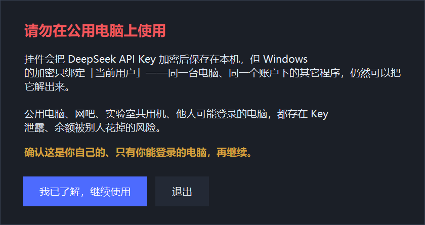
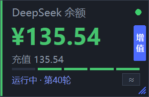
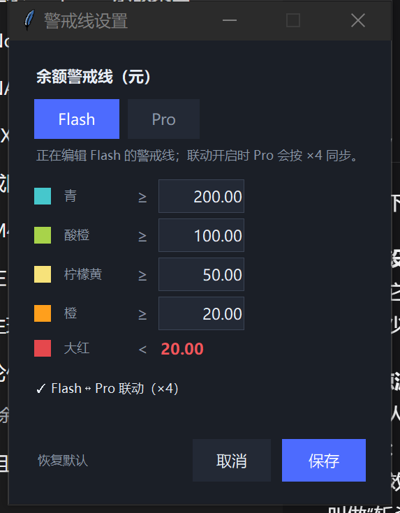
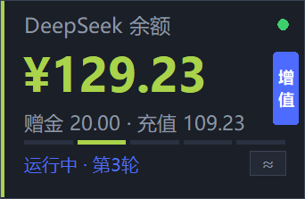
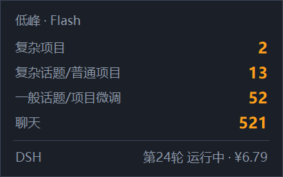
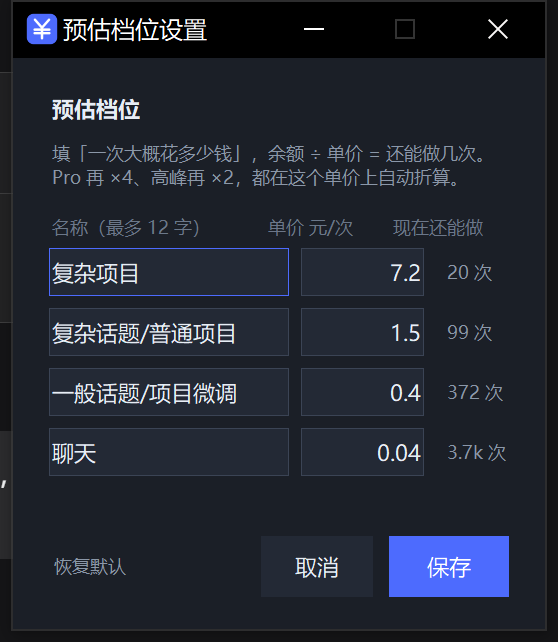
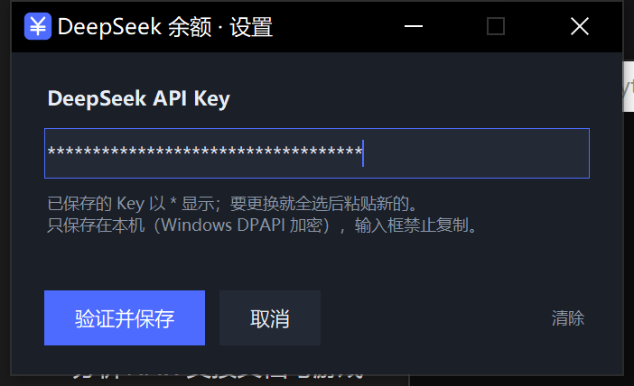
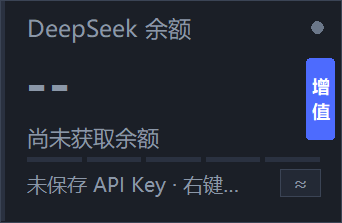

# DeepSeek 余额挂件

一个常驻桌面右上角的小挂件，实时显示 DeepSeek API 账户余额。
Windows · Python 标准库 + tkinter · 不需要 pip 装任何东西 · 单文件可跑。

> 非官方项目：与 DeepSeek 官方无隶属关系，"DeepSeek" 只用来指代它对接的 API。

> ⚠️ **请勿在公用电脑上使用。** 挂件把 API Key 加密存在本机，但 Windows 的 DPAPI 只绑定
> "当前用户"——同一台电脑、同一个账户下的其它程序仍然能把它解出来。
> 公用电脑、网吧、实验室共用机、他人可能登录的机器，都存在 Key 泄露、余额被花掉的风险。
>
> 所以**首次启动会先弹一次这个警告**，点「我已了解，继续使用」才会出现挂件：
>
> 
>
> 想再看到它：把 `%APPDATA%\DeepSeekBalance\config.json` 里的 `warning_ack` 改成 `false`。



- 单文件 Python 程序，只用标准库 + tkinter，**不需要 pip 安装任何东西**
- 无边框、置顶、可拖动，双击刷新，右键菜单
- 大小三档可调（默认"中"：190×124 逻辑像素，物理像素 = 逻辑 × 系统缩放）
- 五档警戒色 + 底部刻度，余额水位一眼可见
- 右下角 `≈` 点开看：这些钱还能做多少次活（按当前模型和时段折算）
- 右边缘一条 DeepSeek 蓝的「增值」竖条，点一下打开官方充值页
- **DSH 联动**：显示"运行中 · 第几轮"，任务结束时弹提醒（只报耗时，不报钱）
- **跟随 DSH 模型**：你在 DSH 里换 Flash / Pro，警戒线自动跟着换
- 自动刷新频率四档可选（20 秒 / 1 分钟 / 2 分钟 / 5 分钟，默认 5 分钟），失败自动退避重试
- API Key 用 Windows DPAPI 加密存本机；输入框星号显示、禁止复制

## 启动

三种方式，按场景挑：

| 方式 | 说明 |
| --- | --- |
| 桌面快捷方式 | 「DeepSeek 余额」直接双击，图标是挂件自己的 |
| `启动挂件.bat` | 项目文件夹里，双击即可（优先 `pythonw.exe`，不弹黑框） |
| 跟随 DSH | 右键 →「跟随 DSH 启动」，之后 **DSH 一开，挂件自动在跑** |

「跟随 DSH 启动」会写一条 `HKCU\...\Run\DeepSeekBalanceFollower`，登录后由 `tools/follow_dsh.py` 常驻（无窗口，每 2 秒看一眼进程表）：

- DSH 启动而挂件没在跑 → 自动拉起
- 挂件已经在跑 → 不重复启动
- 关掉开关时会给跟随进程发停止事件，2 秒内退出，不用重启系统

想改"重启"语义（每次 DSH 启动都杀掉旧挂件重开，调试用）：

```bat
python tools\follow_dsh.py --restart
```

### 被强杀后怎么自己回来

跟随进程和挂件都是 `pythonw.exe`，遇到 `taskkill /IM pythonw.exe` 这类批量清场会**一起被杀**，那时候没人负责重启。所以多一层保险：

右键 →「强制关闭后自动恢复」，注册一个计划任务 `DeepSeekBalanceFollowerKeepAlive`：

| 项 | 值 |
| --- | --- |
| 运行身份 | 当前用户，**不需要管理员**，只在登录时运行（能在桌面上画窗口） |
| 频率 | 每 5 分钟一次，动作是拉起跟随进程 |
| 开销 | 跟随进程有互斥量，已经在跑时新进程约 50 ms 就退出 |
| 效果 | 挂件 + 跟随进程同时被杀 → 最多 5 分钟（再加 4 秒确认）恢复 |
| 细节 | 用 PowerShell 的 `Register-ScheduledTask` 注册：允许电池供电启动、没有 72 小时执行上限（这两条是 `schtasks` 默认值，笔记本上会悄悄失效） |

实测（先把所有 `pythonw.exe` 杀光，0 个残留，然后手动触发这个任务）：

```
2026-10-25 02:16:13 跟随进程启动（restart=False）
2026-10-25 02:16:18 跟随进程：发现挂件不在了，重新拉起（02:16:18）
2026-10-25 02:16:19 启动 pid=14644 位置=2466,938 尺寸=304x198 缩放=1.6
```

十几秒内挂件就回来了（计划任务 5 分钟一跳，这里是手动触发，等于最坏等 5 分钟）。

几个约定：

- 只在「跟随 DSH 启动」打开时可用；**关掉它时这个计划任务会被一起删掉**，不会偷偷再拉起
- 主动点「退出」仍然有效：会写 `paused.flag`，跟随进程看到标记就不复活（DSH 退出后标记自动清掉）
- 项目文件夹挪了位置或者换用打包版，需要重新勾一次（任务里记的是绝对路径）
- 单文件版每次触发都要解压 12 MB；如果常驻守护，建议用文件夹版

命令行等价操作：

```bat
schtasks /Query  /TN DeepSeekBalanceFollowerKeepAlive    :: 看状态
schtasks /Run    /TN DeepSeekBalanceFollowerKeepAlive    :: 立刻触发一次
schtasks /Delete /TN DeepSeekBalanceFollowerKeepAlive /F :: 删掉
```

命令行直接启动也可以：

```bat
pythonw deepseek_balance_widget.py
```

## 首次使用

1. 右键挂件 →「修改 API Key…」，把 Key 粘进去（[platform.deepseek.com](https://platform.deepseek.com) → API keys 页面创建）
2. 点「验证并保存」，验证通过后立刻显示余额
3. 设置窗只在需要时出现，Key 加密保存在本机

> 挂件第一次启动**不会**自动弹设置窗：弹窗会抢走键盘焦点，任何来源的误输入（自动化脚本、隔壁的 agent 会话）都可能落进 Key 输入框。现在改成卡片上提示"右键设置"，由你主动打开。

## 操作

| 操作 | 效果 |
| --- | --- |
| 左键拖动 | 移动挂件，位置自动记住 |
| **拖右下角斜纹手柄** | **等比例缩放（0.60~1.20），松手即记住** |
| 双击 | 立即刷新 |
| 右键 | 菜单：刷新 / 刷新频率 / 修改 Key / 总在最前 / 开机自启 / 跟随 DSH 启动 / 强制关闭后自动恢复 / 显示 DSH 状态 / 跟随 DSH 模型 / 锁定位置 / 允许脚本拖动 / 大小 / 警戒线设置 / 预估档位设置 / 退出 |
| 点 `≈` | 详情浮层（20 秒后自动关） |
| 点「增值」 | 打开官方充值页 `platform.deepseek.com/top_up` |
| 点提醒浮窗 | 立刻关掉 |

**大小不再只有三档**：右下角有个斜纹手柄，按住往右下拖就是放大、往左上拖就是缩小，横向拖动量换算成缩放比，高度按 190:124 跟着变，所以永远是等比例的。范围 0.60~1.20，松手写进 `config.json` 的 `ui_scale`。

**刷新频率四档可选**：右键 →「刷新频率」→ 20 秒 / 1 分钟 / 2 分钟 / 5 分钟（默认 5 分钟），
选完立刻按新间隔重排，写进 `config.json` 的 `refresh_seconds`。
失败重试的退避上限跟着走，但不会低于 60 秒——网络断了不该每 20 秒猛敲一次。

> 20 秒档一天约 4300 次请求。余额接口是只读的免费接口，但也别在多人共用的 Key 上开这么密。

拖动时每变化 0.8% 才重建一次布局，所以既跟手又不会卡；缩放过程中窗口左上角保持不动。

缩放的跟手性靠**两个通道**保证：鼠标 `<B1-Motion>` 走事件，同时有一个 16ms 的轮询在兜底——
按住手柄把指针拖到窗口外时 Windows 就不再派发移动事件了，只靠事件会"拖到一半卡住"；
轮询直接读 `GetCursorPos`，按键松开（`GetAsyncKeyState`）就收尾，所以松开事件丢在窗口外也不会卡在缩放态。
右键 →「大小」里的 小(0.80) / 中(0.90) / 大(1.00) 仍然保留，当作快捷档。

> 2026-10-18 版式收紧过一次：卡片从 244×122 基准缩到 190×124，字号重新配比（金额 31 / 副行 12 / 标题 13 / 页脚 11）。旧配置里的 `ui_scale` 会在启动时自动换算并吸附到最近一档，观感尺寸不变、字变大。

页脚有四种内容，优先级从高到低：**正在刷新 → 出错 → 运行中 · 第 N 轮 → ✔/⚠ 上一轮结果（8 秒） → 更新于 HH:MM:SS**。

右上角那个位置是状态点：**绿**=正常，**蓝**=正在刷新，**黄**=有缓存但本次失败，**红**=出错或余额不足，**灰**=尚未设置 Key。

右边缘那条蓝色竖条是「增值」：DeepSeek 蓝 `#4D6BFE`，两个字竖排，贴着右边框；鼠标移上去提亮、光标变手型，点一下用默认浏览器打开充值页。它夹在右上角状态点和右下角 `≈` 中间，文字区会自动给它让出宽度，余额再长也不会压上来。

## 看到的数字

- 大字是 `total_balance`（赠金 + 充值）
- 小字是构成：`赠金 xxx · 充值 yyy`（`granted_balance` / `topped_up_balance`）
- **哪一项为 0 就不显示那一项**：赠金用完之后那半句直接消失，只留「充值 148.41」；
  两项都是 0 时整行留空，不再挂个 `赠金 0.00 · 充值 0.00` 占地方
- 数据来自官方只读接口 `GET https://api.deepseek.com/user/balance`
- 左侧竖条和底部五段刻度表示余额水位（见下一节）

## 五档警戒色

色带只表达"还剩多少钱"，和状态点（连没连上、刷新成没成）是两套互不干扰的颜色。

| 档 | 区间（默认） | 竖条颜色 | 金额 | 底部刻度 |
| --- | --- | --- | --- | --- |
| 1 | ≥ 200 | `#3ABFE0` 青 | 同竖条色 | **5 段全亮** |
| 2 | 100 – 200 | `#46C46E` 绿 | 同竖条色 | 4 段亮 |
| 3 | 50 – 100 | `#FFE45C` 柠檬黄 | 同竖条色 | 3 段亮 |
| 4 | 20 – 50 | `#FF8420` 橙 | 同竖条色 | 2 段亮 |
| 5 | < 20 | `#E5484D` 大红 | `#f2555a`（更亮，保证可读） | 1 段亮 |

- 金额跟着档位走：余额在青色区间，数字就是青色，一眼能看出水位
- **底部刻度现在是"油量表"**：余额越高亮得越多，亮着的段统一用当前档位的颜色。
  亮块**右对齐**——余额往下掉时从左边一段段熄灭，只剩最右那格红；余额充足时五段全亮。
  这样"剩下的那截"始终在右边，扫一眼就知道还剩几格
- 第 5 档的金额用稍亮的红（对比度 4.22 → 4.90），和竖条仍是同一色系
- 边界值归入**较高**一档（`total == 200` 算第 1 档）
- `is_available == false`（余额不足、API 停用）时强制第 5 档，不看阈值
- 没有数据 / 没设 Key / 首次启动：竖条与刻度全灰 `#2a3140`，金额显示 `--`
- 刻度条既是给你看的"还剩几格"，也是给色弱用户的冗余编码——段数就能读出水位
- 查询失败时金额会压暗（灰），表示"这个数字不可信了"，恢复后自动回到档位色

### 配色对比度（2026-10-25 复查）

用 `tools\contrast_check.py` 算的：WCAG 相对亮度、CIE ΔE2000，外加绿色弱/红色弱模拟（Machado 2009）。

| 档 | 颜色 | 对比度 vs 底色 `#1b1f27` | WCAG |
| --- | --- | --- | --- |
| 1 青 | `#3ABFE0` | 7.63 | AAA |
| 2 绿 | `#46C46E` | 7.38 | AAA |
| 3 柠檬黄 | `#FFE45C` | 12.98 | AAA |
| 4 橙 | `#FF8420` | 6.74 | AA |
| 5 大红 | `#E5484D` | 4.22 | AA（大字号 ≥3 已满足） |
| 5 金额 | `#f2555a` | 4.89 | AA |

相邻档色差 ΔE2000（>10 明显可分）：

| 相邻 | 正常 | 绿色弱 | 红色弱 |
| --- | --- | --- | --- |
| 青 → 绿 | 36.8 | 39.5 | 39.3 |
| 绿 → 柠檬黄 | 31.1 | **19.5** | **13.7** |
| 柠檬黄 → 橙 | 32.0 | **13.6** | 20.1 |
| 橙 → 大红 | 25.6 | 14.1 | 22.4 |

**最弱的一对从 6.7 提到 13.6**（色弱模拟下），四对全部 ≥13.6。

两轮调整的过程：

| 轮次 | 青 | 绿 | 黄 | 橙 | 最弱色弱 ΔE |
| --- | --- | --- | --- | --- | --- |
| 最初 | `#46C7CC` | `#A8D34A` | `#F7E27A` | `#FF9F1C` | 6.7 |
| 第一轮 | `#46C7CC` | `#7FBF2E` | `#FFE45C` | `#FF9F1C` | 11.7 |
| **现在** | **`#3ABFE0`** | **`#46C46E`** | `#FFE45C` | **`#FF8420`** | **13.6** |

最后一轮按你的要求：青更蓝（色相 182° → 196°）、绿更青（86° → 137°）、橙更红（35° → 26°），
柠檬黄和红不动。改完青→绿、黄→橙、橙→红三对的色弱区分度都变好了。

顺手修的两处小字（都是深底上低于 AA 的）：

| 元素 | 原来 | 现在 |
| --- | --- | --- |
| 页脚「更新于 / 点一下关掉」 | `#6b7789` 3.64 | `#7f8ba0` **4.80** |
| 页脚「运行中 · 第 N 轮」 | `#4d6bfe` 3.81 | `#7d93ff` **5.89** |

还差一点点的一处：**「增值」按钮的白字在 `#4D6BFE` 上是 4.33**（标准 4.5）。
因为要保留 DeepSeek 品牌蓝没动；要严格达标把按钮底色压到 `#4460F0`（5.03）即可，是一行常量的事。

> 老版本存下来的默认配色会在启动时自动升级到新值；**自己改过颜色的不动**。

## 自定义警戒线

右键 →「警戒线设置…」：



- 必须**从左到右严格递减**（上面的数要比下面大），否则保存时提示、不改动
- 最后一个颜色（大红）的边界跟着第四个格子实时变，不用单独填
- 「恢复默认」把四个格子填回默认值，点保存才生效
- 保存后立刻重画，不用重启

**Flash / Pro 两套警戒线**：设置窗顶部可以切换，两套各自记住自己的四条线。

- 默认开启「Flash ↔ Pro 联动（×4）」：改 Flash 的四条线，Pro 自动 = ×4；改 Pro 的，Flash 自动 = ÷4
- 关掉联动就可以各改各的
- 为什么是 ×4：官方价 Pro 比 Flash 贵——输入 4.5×、输出 3.375×、缓存命中 7.5×，按不同读写比和缓存率加权后落在 **3.4～4.3**，取 4 最省心

改颜色仍然编辑 `config.json`（没有做取色器）：

```json
"band_colors": ["#3ABFE0", "#46C46E", "#FFE45C", "#FF8420", "#E5484D"],
"bands": {
  "flash": [150, 70, 30, 15],
  "pro":   [600, 280, 120, 60]
},
"model": "flash",
"band_link": true
```

每条线必须是 4 个严格递减的非负数，颜色必须是 5 个 `#RRGGBB`；任何一项不合法就整体回退默认值，不报错、不影响余额显示——所以手改坏了也不会把挂件弄挂。

## DSH 联动

挂件会**只读**这一份文件：

```
%USERPROFILE%\.dsh\storages\session_projcache\sessions\session-*.json
```

这是 DSH 自己维护的会话状态缓存（约 5 秒写一次）。挂件取"最近被写过的那一个"，读里面的
`turnBoundary`（是否有一轮没结束）、`sessionStats`、`tokenUsage.totals`、`modelSelection`、
`contextPressure`。**不联网、不写 DSH 的任何文件、不装插件、不调用它的内部接口。**

### 它到底读了什么（隐私边界）

**默认就开着，不需要你先点同意**：装好一启动就开始看这个目录，有缓存就显示状态，没有就静默跳过。
缓存文件超过 4 MB 直接不看（防止被替换成一个大文件把界面线程卡住）。

只取状态类字段，**会话正文一个字都不碰**：

| 读 | 不读 |
| --- | --- |
| 这一轮开没开、第几轮、几步 | 你的提问、模型的回答 |
| token 桶（缓存命中 / 未命中 / 输出） | 你的文件内容、工具调用参数 |
| 当前模型（flash/pro）、思考档位 | 密钥、账号、任何凭据 |
| 上下文占用、重试计数、缓存时间戳 | 会话正文（`turnOutline` 里的 prompt/response） |

`tools\privacy_probe.py` 是这套边界的回归测试：造一份假会话缓存，标题和提示词里塞 canary 字符串，
把 `USERPROFILE` / `APPDATA` 指到临时目录跑一遍，再检查 canary 有没有出现在磁盘、界面文字、
返回的 state 里。当前结果：磁盘 0、界面 0、state 0。

写下来的东西里也没有 DSH 的数据——`config.json` 只存余额缓存和窗口位置，`app.log` 只记
"第 N 轮结束：238s，重试 0"这种，不含标题和提示词。

### 包装版也一样（实测）

给 exe 造一个假的 `%USERPROFILE%\.dsh\...\session-*.json`（`openTurnStartSeq` 有值），
不改任何设置直接启动，页脚立刻显示"运行中 · 第 3 轮"——识别是**自动**的，
不需要先打开 DSH，也不需要配路径。



### 版本依赖：它到底"绑"了 DSH 什么

**绑的是磁盘上的会话缓存格式，不是 DSH 的 API。** DSH 没有对外暴露这个格式，所以这算内部耦合，
需要正眼看待。具体面有三处：

| 耦合点 | 具体值 | 变了会怎样 |
| --- | --- | --- |
| 缓存目录 | `~\.dsh\storages\session_projcache\sessions\session-*.json` | 找不到文件 → 只是没有 DSH 状态，余额功能不受影响 |
| 缓存结构 | 顶层 `version=7`、`record.identity.formatVersion=4`、`record.rows` 里 27 个字段 | 见下面 |
| 进程名 | 跟随进程靠 `deepseek harness.exe` 判断 DSH 在不在跑 | DSH 改名 → 自动拉起失效（手动启动照常） |

挂件只读 27 个字段里的 **8 个**：`turnBoundary`、`sessionStats`、`tokenUsage.totals`、
`modelSelection`、`contextPressure`、`timeContext`、`title`、`llmRetry`。

**版本号现在会被记下来**：`read_session()` 返回 `cache_version` / `record_version` / `compat`。
号对不上时**不罢工**——照旧尽力解析旧字段，只在 `app.log` 写一条：

```
DSH 会话缓存格式变了：缓存 v8 / record v5（认识的是 v7 / v4），按旧字段尽力解析
```

理由是"字段还能读到就别停"，只把问题留痕，等真出问题时有据可查。

### 格式变了会怎样（14 种破坏性测试）

`tools\dsh_compat_probe.py` 拿真实缓存做基准，逐个破坏后喂给解析器：

| 破坏方式 | 结果 |
| --- | --- |
| 去掉 `record` / 去掉 `rows` / `rows` 变成数组 | 当作没数据（DSH 状态消失，余额正常） |
| 版本号改成 99 | **照常解析**，`compat=False` |
| 删掉 `turnBoundary` / `val=None` | 解析继续，`open_turn=None` → 页脚回到"更新于" |
| `outputTokens` 变成字符串 | 该项算 0，其余不受影响 |
| `modelSelection` 变成字符串 | `model=None`，不跟随模型 |
| 截断 / 空文件 / 非 JSON | 当作没数据 |
| UTF-8 BOM | 正常解析（`utf-8-sig`） |
| 5 MB 大文件 | 大小闸门挡掉（`>4 MB` 不读） |

**14 种输入没有一种能让解析器抛异常**——最坏是"没有 DSH 状态"，不会影响余额显示。
DSH 升级后想自查，跑这一条就够：

```bat
python tools\dsh_compat_probe.py
python dsh_state.py            :: 顺便看看"格式"那行的版本号
```

### 1. 任务状态（页脚）

| 状态 | 页脚 | 说明 |
| --- | --- | --- |
| 正在跑 | `运行中 · 第 19 轮`（蓝） | `openTurnStartSeq` 有值 |
| 刚结束 | `✔ 第 19 轮 完成`（绿） | 停留 8 秒，再回到"更新于" |
| 有过重试 | `⚠ 第 19 轮 · 重试 2 次`（黄） | `llmRetry` 非空 |
| DSH 没开 | `更新于 01:31:44`（灰） | 缓存 15 分钟没动就认为闲置 |

### 2. 完成提醒

一轮结束时在卡片下方弹一个小浮窗，只写耗时：


点一下关掉，或者 10 秒后自己消失。**不抢焦点**，不打断你正在打的字。
菜单里的「显示 DSH 状态」可以整个关掉（页脚状态 + 提醒一起关）。

> 这里**故意不报"这一轮花了多少钱"**：轮次结束是轮询发现的，token 增量天然滞后，
> 同一轮算出来时多时少，报个不准的数不如不报。真要算钱，看浮层底部那个"本会话"。

### 3. 跟随模型

菜单 →「跟随 DSH 模型」默认开着：你在 DSH 里切到 Pro，挂件立刻换成 Pro 那套警戒线，
金额的颜色和档位跟着变，不用手动去设置里点。

- 只在缓存**新鲜**（15 分钟内写过）时才跟随，避免半夜开机被昨天残留的 Pro 记录改掉手选的配置
- 关掉它就完全手动
- 换模型那一刻如果没在跑任务，页脚会提示 `警戒线 → Pro`

### 本会话花了多少是怎么算的

浮层底部那一行（`第 24 轮 运行中 · ¥6.79`）用的是 `tokenUsage.totals` 的累计值，
按官方价换算（元 / 百万 token，低峰）：

| | 缓存命中 | 未命中输入 | 输出 |
| --- | --- | --- | --- |
| Flash | 0.02 | 1.0 | 4.0 |
| Pro | 0.15 | 4.5 | 13.5 |

高峰时段（工作日 9:00–12:00、14:00–18:00）整体 ×2。累计值没有滞后问题，但它仍然是**按价目表推算**的：
高峰跨越、缓存写入、检索调用都没单独计。

实测参考（本项目 19 轮对话）：缓存读 1.58 亿 token 占花费 63%，输出 42 万 token 占 33%，
未命中输入 24 万 token 占 4%，合计约 ¥5.1，平均每轮 ¥0.27。

### 已知限制

- DSH 的 `formatVersion` 是内部字段，升级后可能变。挂件所有取值都带默认值，**读不到就退化成没有这个功能**，不会崩。
- 失败原因读不到：会话正文文件被 DSH 独占锁定，只能从 `llmRetry` 推断"出过错"，拿不到错误原文。
- 同时开多个 DSH 会话时，只看最近被写的那一个。

## 预估：这些钱还能做多少活

点页脚右下角的 `≈`：



按当前模型 + 当前时段折算成次数：

| 档位 | 单价（Flash · 低峰） | 相对最初口径 |
| --- | --- | --- |
| 复杂项目 | 7.2 元/次 | ×1.2 |
| 复杂话题/普通项目 | 1.5 元/次 | ×1.5 |
| 一般话题/项目微调 | 0.4 元/次 | ×2 |
| 聊天 | 0.04 元/次 | ×2 |

单价整体上调过一轮，**口径偏保守**——宁可少报次数，也别让人看着"还能做 1.1k 次"以为很宽裕。真跑起来超一点，比差一半好。

### 自定义档位：名字和单价都能改

右键 →「预估档位设置…」：



- 每个档位两个格子：**名称**（最多 12 字）+ **单价**（元/次，Flash 低峰口径）
- "预计使用次数"就是 **余额 ÷ 单价**，所以想让它更保守/更宽松，改单价就行
- 右边「现在还能做」是**实时**算的，改单价立刻能看到变化
- 恢复默认 / 保存 / 取消；名称空、单价非数字或 ≤ 0 时保存会提示并拒收
- 存进 `config.json` 的 `estimate`，四档顺序固定（从贵到便宜），任何一项坏了整体回退默认值

```json
"estimate": [
  {"name": "复杂项目", "price": 7.2},
  {"name": "复杂话题/普通项目", "price": 1.5},
  {"name": "一般话题/项目微调", "price": 0.4},
  {"name": "聊天", "price": 0.04}
]
```

- **Pro**：单价 ×4，次数 ÷4
- **高峰**：单价 ×2，次数 ÷2。判定规则是周一至周五 9:00–12:00、14:00–18:00（北京时间），周末全天低谷
- **法定节假日识别不了**——节假日白天会按高峰算，次数偏保守（少一半）

有 DSH 会话时，浮层底下再加一行"第 21 轮 运行中 · 本会话 ¥6.36"——这个数是从 token 实际用量算的，不是估的。

浮层 20 秒后自动消失，不抢焦点、不挡操作。

> 次数是"量级估计"，不是精确结算：缓存命中能把输入打到 2%，思考模式又能让输出翻几倍。同一件事可能花一半也可能花两倍。看趋势，别当账单。
>
> 也**没有做**"今天花了多少 / 还能撑几天"这类按天统计：余额 5 分钟才查一次，落账时刻和真实消费时刻差着几分钟，跨零点时更会算错天，做出来反而误导人。

## 为什么它不会被"别人"拖走

挂件是置顶的，鼠标划过时很容易吃到别的程序（尤其是自动化脚本、GUI agent）发来的点击。所以拖动前有两道闸门：

1. **注入检测**：`GetCurrentInputMessageSource` 能区分 `IMO_HARDWARE`（真实鼠标）和 `IMO_INJECTED`（`SendInput` / `mouse_event` / 自动化工具）。注入的点击不会启动拖动。菜单里的「允许脚本拖动」可以关掉这道闸门。
2. **锁定位置**：勾选后彻底禁止拖动，连真实鼠标也拖不动。

实测：同一段注入脚本，防护开时窗口纹丝不动，关掉后被从 (300,200) 拖到 (420,260)。

> 如果你用远程桌面/远控软件，而它们的点击被判定成注入导致拖不动，右键勾上「允许脚本拖动」即可。

## Key 的安全处理



- 保存前用 Windows DPAPI（`CryptProtectData`）加密，密文只有当前 Windows 用户能解开
- 配置文件里没有明文 Key，日志里也不会写 Key
- 设置窗里 Key 以 `*` 显示，`Ctrl+C` / `Ctrl+X` / 剪切全部被拦截，没法把明文复制出去
- **首次启动先弹安全提示**（公用电脑警告），点「我已了解」才继续；设置窗顶部也常驻一行红字提醒
- 也支持环境变量 `DEEPSEEK_API_KEY` 作为兜底；界面上填过的 Key 优先级更高
- 要换 Key：右键 →「修改 API Key…」→ 全选后粘贴新的；点「清除」可以删掉本机保存的 Key

### 能保护到什么程度（别高估）

**能防住的**：拷走 `config.json` 换台电脑用（DPAPI 绑定用户+SID）、配置文件被云盘同步走
（同步出去的是密文，另一台机器解不开）、日志/崩溃信息里翻到 Key（从来没写过）。

**防不住的**：

- **同一个 Windows 用户下的任何程序**都能解开——DPAPI 的模型就是"这个用户的东西这个用户能读"。
  `tools\verify_build.py` 本身就是一个现成的反例：它以普通子进程身份把 Key 解出来做了比对。
  所以别在同一账户下跑不明来源的程序，这是用 Windows 的前提，不是挂件的漏洞。
- Key 在网络请求时以明文存在内存里（`Authorization: Bearer ...`），进程内存被 dump 就能拿到。
- 以管理员权限运行的程序能读你的进程内存、也能直接调 DPAPI。

**传输路径**：只发往 `https://api.deepseek.com/user/balance`，走系统默认 TLS 校验（urllib 不做
证书例外），Key 只放在 `Authorization` 头里，不进 URL、不进日志、不进错误提示
（401/403/429 的原始报文被显式丢弃，只给中文提示）。
「增值」按钮打开的是固定地址 `platform.deepseek.com/top_up`，不接受任何外部输入。

## 文件位置

```
%APPDATA%\DeepSeekBalance\
├── config.json   # 加密后的 Key、窗口位置、警戒线、模型、余额缓存
├── app.log       # 出错时的日志（不含 Key）
├── icon.png
└── icon.ico
```

项目文件夹：

```
DeepSeekBalance\
├── deepseek_balance_widget.py   # 主程序（界面 + 轮询 + 菜单 + 看门狗）
├── dsh_state.py                 # 读 DSH 会话缓存、按 token 算钱（可单独跑）
├── build_exe.py                 # 打包成 exe（PyInstaller）
├── sign_exe.py                  # 给 exe 签名（自签名 / PFX / 证书存储）
├── dist\                        # 打包产物（exe + 文件夹版 + 使用说明）
├── tools\follow_dsh.py          # 源码模式的跟随入口（转发给 follow_main）
├── tools\verify_build.py        # 打包产物安全检查（Key 有没有被打进去）
├── tools\privacy_probe.py       # 隐私探针（DSH 会话内容有没有被读/被写）
├── tools\input_probe.py         # 鼠标事件取证工具
└── tools\shot.ps1               # 只读截图（不移动指针）
```

## 打包成分发版（exe）

做给"别的电脑上也能双击就用"的版本：

```bat
python -m pip install pyinstaller     :: 只需一次
python build_exe.py                   :: 两种都打
python tools\verify_build.py          :: 复核产物里没有 Key
```

产物在 `dist\`：

| 文件 | 大小 | 说明 |
| --- | --- | --- |
| `DeepSeekBalance.exe` | 12 MB | 单文件，拷一个就能跑（运行时会解压到系统临时目录） |
| `DeepSeekBalance-portable\` | 25 MB | 文件夹版，不解压、启动更快，整个目录一起拷 |
| `使用说明.txt` | — | 给拿到 exe 的人看的两分钟说明 |

**没有 Key 被打进去**，这是设计上的硬约束：

- Key 只存在 `%APPDATA%\DeepSeekBalance\config.json`，用 DPAPI 加密，DPAPI 绑定当前 Windows 用户，
  所以就算把 config.json 拷到别的电脑也解不开；
- 源码里没有任何 Key 字面量，打包也只收 `.py`，不收 `%APPDATA%` 里的运行期文件；
- 打完必须跑 `tools\verify_build.py`，它会把 exe 里的 PyInstaller 归档拆开
  （每个模块的字节码 + `base_library.zip` 的每个成员），用 Key 的
  明文 / UTF-16 / base64 / DPAPI 密文五种形态去搜；同时检查源码树、`dist` 里有没有混进
  `config.json`、`app.log`，以及运行期的 `%APPDATA%\DeepSeekBalance\*` 里有没有明文 Key。

> 验证过一次：把 `config.json` 挪走再启动 exe，卡片显示 `--` 和"未保存 API Key · 右键设置"，
> 说明它确实没有可用的内置 Key。当前版本：源码 12 个文本文件、产物 25 个文件 + 487 个归档条目、
> 运行期 4 个文件，**全部命中 0**。
>
> 

两个现实注意点：

- exe **没有数字签名**，第一次运行 SmartScreen 会提示"Windows 已保护你的电脑"，点「更多信息 → 仍要运行」；
- 单文件版启动时要把 12 MB 解压到 `%TEMP%`，如果那台机器的临时目录被策略锁住（或杀软拦壳），
  改用文件夹版——它不需要解压。

## 为什么会被 Windows 拦 / 能不能签名

先把事实摆清楚：**在生成它的这台机器上不会被拦**。实测 `dist\DeepSeekBalance.exe` 没有
`Zone.Identifier`（MOTW，见下表）、Defender 实时保护开着但没有任何告警、智能应用控制处于关闭态，
`--selftest` 直接跑通。

被拦只发生在"这个文件像是从网上下来的"或"目标是新装的 Win11"这两种情况下。三种机制不一样：

| 机制 | 触发条件 | 现象 | 签名有用吗 |
| --- | --- | --- | --- |
| SmartScreen | 文件带 **MOTW**（浏览器/微信/QQ/邮件/网盘的下载标记）+ 无签名无信誉 | "Windows 已保护你的电脑" → 需点"仍要运行" | 有用：受信任的签名相当于自带信誉 |
| 智能应用控制（SAC） | Win11 全新安装且未关闭 | 直接禁止运行，连提示都没有 | 有用：只放行签名且可信的应用 |
| Defender 启发式 | PyInstaller 单文件壳被误判 | 报 `Trojan:Win32/Wacatac.B!ml` 之类并隔离 | 只能提白/换打包方式，签名帮助有限 |

**实测过 MOTW 这条**：把 exe 复制一份、写入 `Zone.Identifier`（模拟"从网上下载"），再启动——
进程根本不出现、`_MEI` 都没解压、`smartscreen.exe` 被唤起；同一份文件去掉标记就正常跑。
所以"发到别人电脑上被拦"基本就是这个原因，跟程序本身没关系。

### 签名实测

```bat
python sign_exe.py --self-test          :: 自签名，只用来验证流程
python sign_exe.py --pfx my.pfx         :: 商业证书（密码走 DSB_SIGN_PASSWORD）
python sign_exe.py --thumbprint <SHA1>  :: 用证书存储里的证书（USB Key 也行）
```

自签名的结果：**能签上、能盖 DigiCert 时间戳、签名后的 exe 照样跑通自检**，但是——

```
SignTool Error: A certificate chain processed, but terminated in a root
certificate which is not trusted by the trust provider.
```

根证书不在别人的受信任列表里，所以 SmartScreen 依旧不认，而且"签名无效"比"没签名"更容易被判成可疑。
自签名只适合内网：用组策略把证书推到内网机器的"受信任的根证书颁发机构"。

要真正消掉提示，只有三条路：

| 方案 | 价格 | 门槛 |
| --- | --- | --- |
| OV 代码签名证书（DigiCert/Sectigo/SSL.com 等） | 约 ¥1500–3000/年 | 个人可申请，需实名+企业/个体资料 |
| EV 代码签名证书 | 约 ¥3000–6000/年 | 需硬件令牌，SmartScreen 立刻建立信誉 |
| Azure Trusted Signing | 约 $9.99/月 | 需通过组织身份验证（个人主体部分地区可） |

拿到证书后跑一遍 `python sign_exe.py --pfx 证书.pfx` 就行，脚本会自动挑最新的 signtool、
盖时间戳、再用 `signtool verify` 复核——上面的自签名流程已经走通过一遍。

### 没证书时的临时办法

1. **别让它带上 MOTW**：U 盘、局域网共享、或让对方右键文件 →「属性」→ 勾「解除锁定」；
2. 发之前公布 SHA256（`Get-FileHash dist\DeepSeekBalance.exe -Algorithm SHA256`），对方自己核对；
3. 实在不行就让对方直接跑源码版（`启动挂件.bat`），源码文件不会被 SmartScreen 拦。

## 常见问题

**显示"API Key 无效或已过期"**
Key 复制不完整、被删除或已失效。右键 →「修改 API Key…」重新粘贴。

**显示"网络连接失败"**
公司网络/代理拦截了 `api.deepseek.com`。挂件会自动重试（60s → 120s → … 最多 5 分钟一次）。

**余额不动？**
DeepSeek 的余额只在你调用 API 之后才变，5 分钟轮询足够。想立刻看，双击挂件。

**页脚一直显示"运行中"，但 DSH 早就干完了？**
DSH 写完一轮才会清掉 `openTurnStartSeq`。如果它是被强杀的，这一步没落盘——挂件会在缓存 15 分钟没更新后自动回到"更新于"。

**没弹完成提醒？**
一轮结束才弹。挂件是在这一轮**开始之后**才启动的话，也能在结束时弹。「显示 DSH 状态」被关掉时不弹。

**开机自启**
右键 →「开机自启」，会写 `HKCU\Software\Microsoft\Windows\CurrentVersion\Run`，不弹 UAC。

**想退出**
右键 →「退出」。挂件不进任务栏，没有关闭按钮，只有这个入口。

**卸载**
退出挂件 → 删除本文件夹 → 删除 `%APPDATA%\DeepSeekBalance` → 若开过机自启，先取消勾选。

## 开发时的小工具

```bat
python deepseek_balance_widget.py --selftest    :: 自检：不碰真实鼠标键盘，验证拖动/菜单/缩放/分档/DSH
python deepseek_balance_widget.py --demo        :: 假数据，不联网，用来调界面
python deepseek_balance_widget.py --pos=300,200 :: 指定初始位置
python dsh_state.py                             :: 看一眼 DSH 现在在不在跑、这一会话花了多少
python dsh_state.py --watch                     :: 每 2 秒刷新，状态变了才打印
python dsh_state.py --json                      :: 机器可读
```

`--selftest` 用 Tk 的 `event_generate` 直接给控件发事件，全程不动系统指针、不抢焦点——这样验证界面不会打断正在用电脑的人，也不会被别的自动化脚本干扰。当前 **47 项全部通过**。

界面截图也可以不动鼠标：

```bat
python deepseek_balance_widget.py --shot=details,toast   :: 启动后自动弹出浮层，方便截版式
powershell -ExecutionPolicy Bypass -File tools\shot.ps1 -Out a.png     :: 按窗口标题只读截图
```

```bat
python tools\input_probe.py 30      :: 取证：30 秒内鼠标事件是真人还是软件注入
```

`input_probe.py` 装一个 `WH_MOUSE_LL` 低层钩子，按 `LLMHF_INJECTED` 区分物理/注入事件，并打印注入发生时的前台窗口。下次再遇到"鼠标被抢"，跑 30 秒就能知道是哪个程序在操作。

其余几个工具：

| 工具 | 用途 |
| --- | --- |
| `tools\verify_build.py` | 打包产物安全检查：Key 有没有被打进 exe |
| `tools\privacy_probe.py` | 隐私探针：DSH 会话内容有没有被读取/落盘 |
| `tools\dsh_compat_probe.py` | DSH 缓存格式兼容性：14 种畸形输入 |
| `tools\contrast_check.py` | 配色对比度：WCAG + ΔE2000 + 色弱模拟 |

## 许可证

[MIT](LICENSE)。代码、图标（运行时用代码生成，不含外部素材）、文档都在这一个许可下。

商用、二次开发、改名分发都可以，保留版权声明即可。

## 参与

- 报 bug 请带上：Windows 版本、`%APPDATA%\DeepSeekBalance\app.log` 末尾几行（**不含 Key**）、复现步骤
- 改界面配色前先跑 `python tools\contrast_check.py`，相邻档 ΔE 别掉到 10 以下
- 改完跑 `python deepseek_balance_widget.py --selftest`，47 项应当全绿
